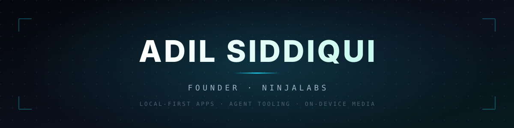
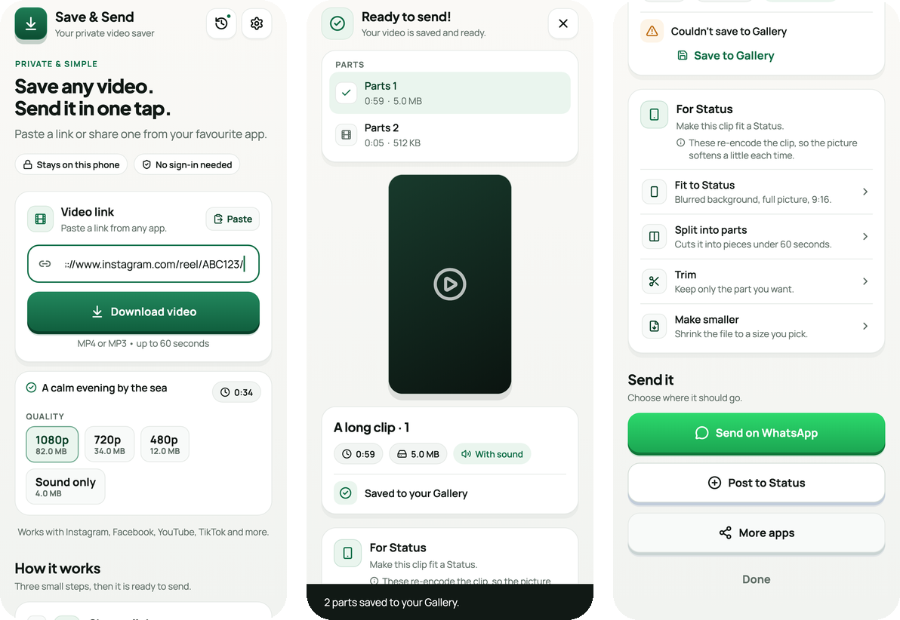

  

  
  
  
  
  

  
  
  

---

## Selected work

### [Save & Send](https://github.com/AdilSiddiquiHQ/save-and-send)

  
  
  
  
  

A private Android app that turns a shared Instagram, Facebook, YouTube or TikTok link into an MP4 that WhatsApp will actually accept. Format selection, audio muxing, trimming and `+faststart` all happen on the phone — no accounts, no analytics, no server that has to be trusted with your links.

  

### [SkillSleuth](https://github.com/AdilSiddiquiHQ/skillsleuth)

  
  
  
  
  

A security scanner for AI agent skills. Every other scanner reads the file; SkillSleuth reads *views* of the file — raw, deobfuscated, decoded and unpacked — so it reports the payload **and** the trick used to hide it. Built as a direct answer to the Trail of Bits audit that walked past the entire first generation of these tools in under an hour each.

  

### [a11y-skills](https://github.com/AdilSiddiquiHQ/a11y-skills)

  
  
  
  
  

33 procedures covering **every WCAG 2.2 Level A and AA success criterion**, plus an audit command that maps each axe-core finding to the exact skill that fixes it. Each skill is a procedure — when to reach for it, ordered steps, a verification step, and the failure modes — because that is the shape an agent can follow and a reviewer can reject in a pull request.

  

### [Drosophila Connectome Chess](https://github.com/AdilSiddiquiHQ/fly-connectome-chess)

  
  
  
  

A biological neural network, digitised and trained to play chess. The open-source fruit-fly connectome — 164,000 neurons — is wired to a chessboard through its simulated optic nerves and descending motor neurons, with a virtual dopamine reward carving pathways into the PyTorch tensor matrix every time it plays a good move.

---

## Stack

  
  
  
  
  

  
  
  
  
  

  
  
  
  
  
  

---

## Numbers

  <picture>
    <source media="(prefers-color-scheme: dark)" srcset="https://github-profile-summary-cards.vercel.app/api/cards/profile-details?username=AdilSiddiquiHQ&amp;theme=github_dark" />
    <source media="(prefers-color-scheme: light)" srcset="https://github-profile-summary-cards.vercel.app/api/cards/profile-details?username=AdilSiddiquiHQ&amp;theme=default" />
    
  </picture>

  

---

## How this started

2023. I was thirteen, writing Discord bots and Minecraft AFK scripts for servers I did not own, with no tests, no CI and no idea what I was doing. Those repos are still public — I keep them because the curiosity in them is the same engine as everything above, just with worse naming.

Everything since has been one long attempt to keep that curiosity and add the discipline.

---

  Most of my work is private. The four above are the ones worth reading.

